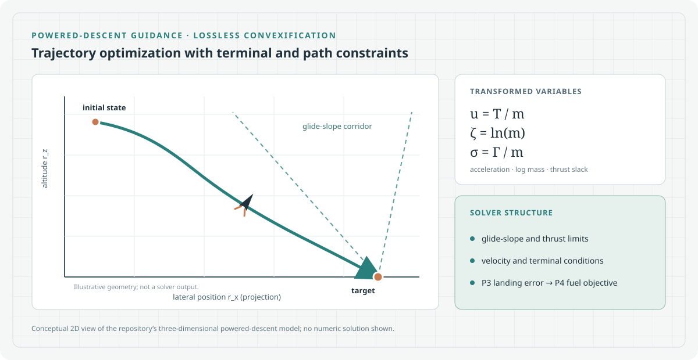

# G-FOLD: Fuel-Optimal Powered Landing Guidance

[Project homepage](https://paoshou-china.github.io/G-FOLD/) · [Source repository](https://github.com/PaoShou-China/G-FOLD)



A Python example of powered-descent trajectory optimization using lossless convexification (LCVX). The repository includes Earth and Mars parameter presets, a two-stage solver, a command-line entry point, an optional Tkinter GUI, and Plotly trajectory and telemetry views.

## Method in this implementation

The solver state is position, velocity, and log mass. It uses the transformed variables:

- (u=T/m): control acceleration
- (zeta=ln(m)): log mass
- (sigma=Gamma/m): scaled thrust slack

The dynamics are discretized with trapezoidal integration. The path constraints in `solver.py` include glide slope, maximum velocity, thrust magnitude, thrust pointing, and Taylor-expanded thrust bounds. Terminal constraints impose zero velocity and zero terminal slack; the P3/P4 stages add their respective landing conditions.

The current two-stage workflow is:

1. **P3:** minimize terminal position error, with terminal altitude constrained to zero.
2. **P4:** use the P3 terminal position as the target, then maximize terminal log mass (equivalent to minimizing fuel use for fixed initial mass).

The flight-time estimate uses a golden-section search around calls to the convex solver. CVXPY is invoked with CLARABEL. See `solver.py` for the precise equations and constraint construction.

## Mission presets

Values below are defined in `mission.py`.

| Preset | Gravity | Dry mass | Fuel mass | Initial wet mass |
| --- | ---: | ---: | ---: | ---: |
| EarthMission | 9.81 m/s² | 5,000 kg | 1,200 kg | 6,200 kg |
| MarsMission | 3.71 m/s² | 2,000 kg | 800 kg | 2,800 kg |

These are simplified configured scenarios, not validated vehicle designs or high-fidelity environmental models.

## Installation

Python 3.10 or newer is recommended. Install the listed Python packages:

```bash
git clone https://github.com/PaoShou-China/G-FOLD.git
cd G-FOLD
python -m venv .venv
# Linux/macOS
source .venv/bin/activate
# Windows PowerShell
.venv\Scripts\Activate.ps1
python -m pip install --upgrade pip
python -m pip install -r requirements.txt
```

The optional GUI uses Tkinter. Some Linux distributions package it separately from Python.

## Quick start

From the repository root:

```bash
python main.py
```

The current constants near the top of `main.py` select the Earth preset, 50 discretization intervals, output file `trajectory_results.json`, and enabled visualization. Edit those constants to change the mission, interval count, output path, or plot setting.

The JSON file records mission metadata and the position, velocity, mass, thrust, slack, and log-mass trajectories. Plotly opens trajectory and telemetry views when visualization is enabled.

To launch the optional desktop interface:

```bash
python gui.py
```

## Repository map

| File | Purpose |
| --- | --- |
| `main.py` | Configures and runs the command-line mission; writes trajectory results and optionally displays plots. |
| `mission.py` | Defines the shared mission parameters and Earth/Mars presets. |
| `solver.py` | Builds the P3/P4 convex programs, estimates flight time, and solves them. |
| `visualize.py` | Creates Plotly 3D trajectory and telemetry views. |
| `gui.py` | Tkinter interface for configuring and viewing trajectory optimization. |
| `index.html` | Static project homepage. |
| `assets/hero.svg` | Source-grounded method schematic; the trajectory drawing is explicitly illustrative. |

## Reproduction notes and limitations

Mission parameters, discretization count, output filename, and visualization toggle are constants in `main.py`; there is no command-line argument parser. Results depend on the installed CVXPY and solver versions. Record the source revision, Python and package versions, mission preset, and configuration when reporting a run.

This code does not implement a full six-degree-of-freedom vehicle model, atmosphere, terrain interaction, or a closed-loop flight controller. The illustration is conceptual and does not depict computed results.

## Reference

A. Açıkmeşe and S. R. Ploen, “Convex Programming Approach to Powered Descent Guidance,” *Journal of Guidance, Control, and Dynamics*, 30(5), 2007.

## License

See [LICENSE](LICENSE).
